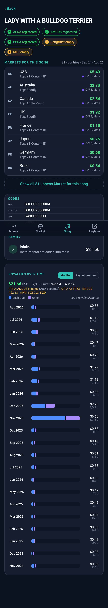

# Royalty Dashboard (beta)

A dashboard for music royalty exports that runs in your browser. Load your files and it shows:

- **Money**: the paid total in USD for the months you pick, then a family rank. Codes for the same master add together. Versions (instrumental, acapella, remix, radio edit) sit under their song and are not added. Guest features are marked and kept out of the rank.
- **Market**: countries by earnings. Open a country for its platforms, social platforms and top songs. Filter by one song.
- **Song**: registration chips, markets for the song, codes (ISRC, GW work, PPL), the family, and royalties over time by month or by APRA AMCOS payout quarter (cash and units, tap a row for platforms).
- **Register**: holes (paid with no APRA work, works with no ISRC, sole-writer shares under 100%, paid but not in PPCA), reserved codes with no master, and old codes that never earned.

Pick a month range, a preset or an APRA AMCOS payout quarter. Search by title, ISRC, UPC, PPL id or GW work id.

## Supported files

- DistroKid all-time earnings export (CSV) and the Instagram/Facebook export (TSV)
- SoundCloud lifetime earnings report (CSV, SoundCloud partner rows)
- APRA AMCOS royalty statements (XLSX or CSV, Australia and New Zealand), plus the Royalty Source Categories List CSVs
- APRA AMCOS Works List (XLSX or CSV)
- PPCA repertoire (XLSX or CSV)
- A .zip holding any of the above

Each file's type is detected from its column headers. Rows already loaded from another file are skipped, not counted twice.

Amounts in different currencies (distributor USD, APRA and AMCOS AUD and NZD) are shown separately and never added together. Anything missing from your files is left blank.

## Run it

`index.html` is the whole app in one file. Open it in a browser, on a phone or a computer. Nothing to install.

Drop your exports onto the page, or choose **Try with demo data**. `index.html?demo=1` opens straight into the demo.

## Build

`index.html` is built from `src/` with `python3 build.py`. It inlines the styles, the app, the libraries in `vendor/`, the logo and the demo pack.

## Demo data

`demo/` holds a demo pack. Every name, title, code and amount in it is fictional.

- `demo/distrokid/`, `demo/soundcloud/`, `demo/apra-amcos/`, `demo/ppca/`: the demo files, in the same formats as the real exports
- `demo/jeremy-legal-demo-pack.zip`: the same pack as one download (also built into `index.html`)

The demo pack is MIT licensed (`demo/LICENSE`).

## Privacy

Your files are read in your browser and never uploaded. No cookies, no analytics, no network requests.

## Licence

MIT. See `LICENSE`.

- SheetJS Community Edition: Apache-2.0, `vendor/LICENSE-SheetJS.txt`
- Papa Parse: MIT, `vendor/LICENSE-PapaParse.txt`

---

By ROBBIE P / Jeremy Legal Records
